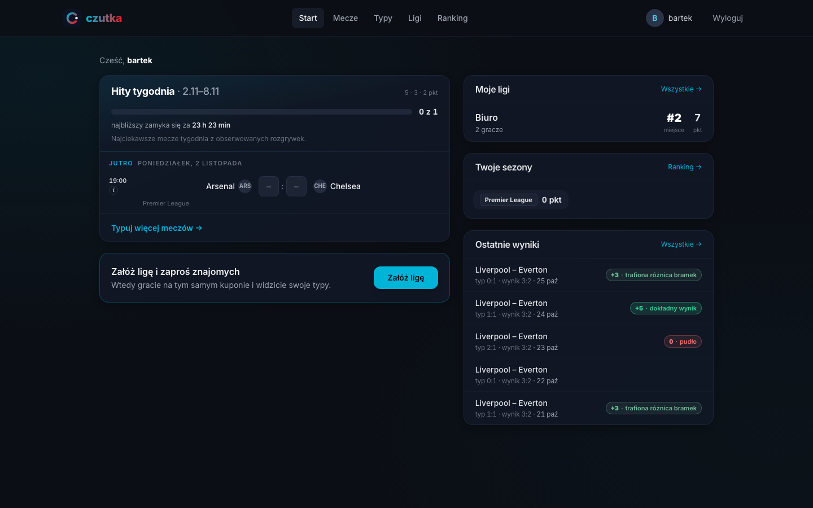
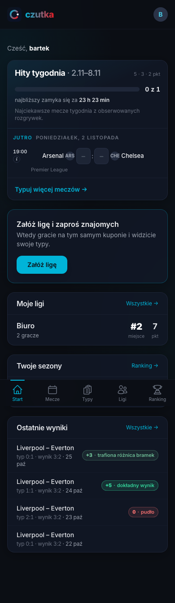
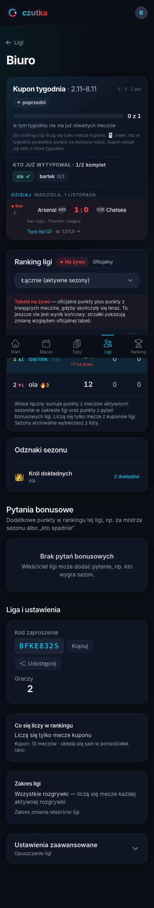
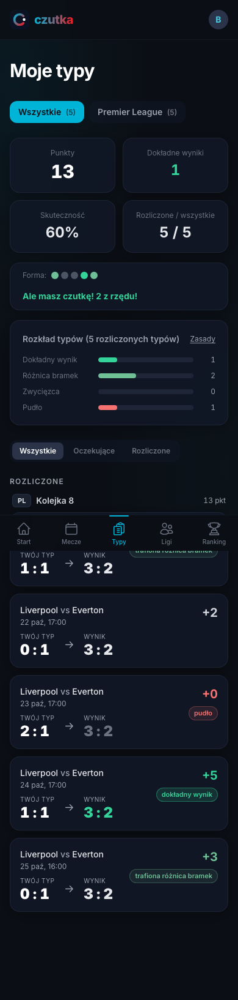

<p align="center">
  
</p>

<h1 align="center">czutka</h1>

<p align="center">
  Typer piłkarski dla znajomych. Zakładasz ligę, co tydzień typujecie wyniki, punkty liczą się same.<br>
  <a href="https://www.czutka.uk"><b>czutka.uk</b></a>
</p>

<p align="center">
  
</p>

<p align="center">
  
  &nbsp;
  
  &nbsp;
  
</p>

Zaczęło się jako typer na Mundial 2026. Ta wersja jest na branchu `mundial-2026`.

## Funkcje

- prywatne ligi z kodem albo linkiem zaproszenia
- kupon tygodnia: kilka meczów, które typuje cała liga, i joker za podwójne punkty
- Liga Mistrzów i pięć największych lig europejskich, wyniki z football-data.org
- typy znajomych widoczne po rozpoczęciu meczu
- punkty i tabela ligi na żywo w trakcie meczów
- pytania bonusowe, serie i odznaki sezonu

Punktacja: 5 pkt za dokładny wynik, 3 za różnicę bramek, 2 za zwycięzcę. W fazie pucharowej
więcej. Szczegóły w [docs/scoring.md](docs/scoring.md).

## Uruchomienie

```bash
cp mundial-backend/.env.example mundial-backend/.env   # ustaw JWT_SECRET
docker compose up --build
```

Aplikacja wstaje na http://localhost:8080, Swagger backendu na http://localhost:8000/docs.
Migracje odpalają się same przy starcie.

## Testy

```bash
cd mundial-backend && uv run pytest
cd mundial-frontend && npm run lint && npm run test:e2e
```

## Stack

React + Vite + Tailwind na froncie, FastAPI z czystym SQL (psycopg2) na backendzie, PostgreSQL.
Produkcja: Vercel, Render i Neon. Więcej o architekturze i decyzjach w [docs/](docs/).
