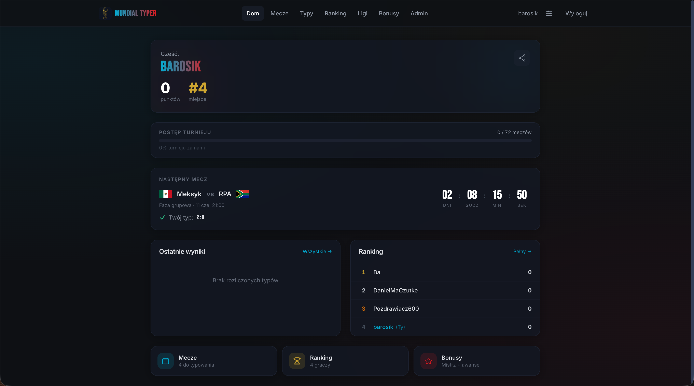
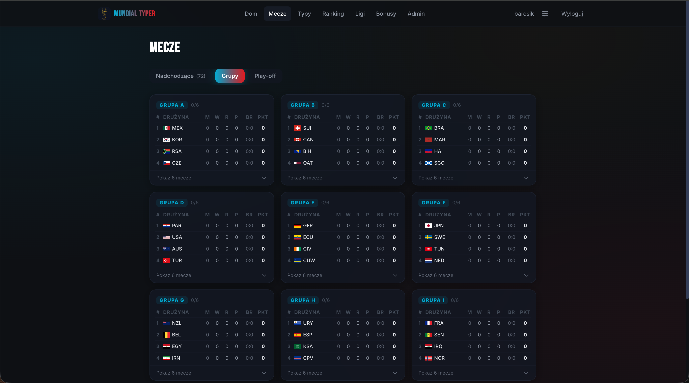
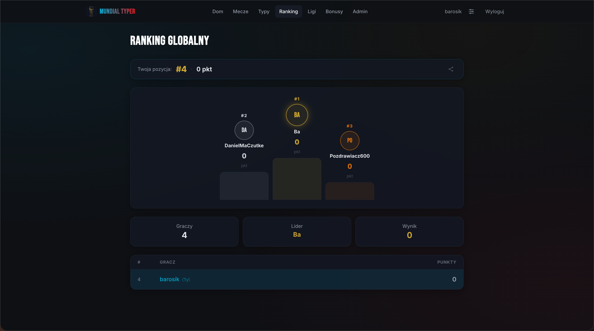

<div align="center">

# ⚽ czutka

**Typuj wyniki meczów ze znajomymi.**
Prywatne ligi, kupon tygodnia, ranking na żywo i odznaki. Bez reklam i bez hazardu.

[**czutka.uk**](https://www.czutka.uk) · [Dokumentacja](docs/README.md) · [API](docs/api-contract.md)


</div>

---

## Jak to działa

1. **Zakładasz ligę** i wysyłasz znajomym link na grupę.
2. **Co tydzień liga dostaje kupon**: kilka najciekawszych meczów z wybranych rozgrywek.
3. **Typujesz wyniki** do pierwszego gwizdka, zapis jest automatyczny.
4. **Punkty liczą się same** po meczu, a w trakcie widać „gdyby się teraz skończyło”.

## Co jest w środku

| | |
|---|---|
| 🏆 **Rozgrywki** | Liga Mistrzów, Premier League, LaLiga, Serie A, Bundesliga, Ligue 1 i archiwum Mundialu 2026 |
| 🎟️ **Kupon tygodnia** | mecze tygodnia dla całej ligi, joker ×2 raz na kupon |
| 👀 **Po gwizdku** | typy znajomych, średni typ ligi i reakcje emoji |
| 📈 **Na żywo** | prowizoryczne punkty i tabela ligi ze strzałkami ▲▼ |
| 🔥 **Grywalizacja** | serie bez pudła i odznaki sezonu (Król dokładnych, Prorok, Maruda…) |
| ❓ **Pytania bonusowe** | mistrz sezonu albo własne pytanie organizatora |
| 📱 **PWA** | instalacja na telefonie jak zwykła aplikacja |

## Punktacja

| Trafienie | Przykład (typ 2:1) | Punkty |
|---|---|:---:|
| Dokładny wynik | 2:1 | **5** |
| Różnica bramek | 3:2 | **3** |
| Zwycięzca | 4:0 | **2** |

Mecze pucharowe są warte więcej (np. finał 15 · 8 · 6). Szczegóły w [docs/scoring.md](docs/scoring.md).

## Uruchomienie lokalnie

Potrzebujesz Dockera.

```bash
cp mundial-backend/.env.example mundial-backend/.env   # uzupełnij JWT_SECRET
docker compose up --build
```

- aplikacja: http://localhost:8080
- Swagger API: http://localhost:8000/docs

Praca z hot-reloadem (backend i front osobno) jest opisana w [CLAUDE.md](CLAUDE.md#jak-odpalić-lokalnie).

## Testy

```bash
cd mundial-backend && uv run pytest        # backend (RUN_DB_TESTS=1 z bazą testową)
cd mundial-frontend && npm run lint        # lint frontu
cd mundial-frontend && npm run test:e2e    # Playwright, główne ścieżki
```

Wszystko odpala się też w GitHub Actions przy każdym pushu.

## Stack

| Warstwa | Technologia |
|---|---|
| Frontend | React 19, Vite, Tailwind, React Router |
| Backend | FastAPI, psycopg2 (czysty SQL), pytest |
| Baza | PostgreSQL 16 (Neon) |
| Dane meczów | [football-data.org](https://www.football-data.org) |
| Hosting | Vercel (front), Render (backend), Neon (baza) |

Jak zmiana trafia na produkcję: [docs/ci-cd.md](docs/ci-cd.md).

<details>
<summary><b>Jak wyglądał Mundial Typer 2026</b> (pierwsza wersja)</summary>

<br>

Wersja z Mundialu jest zachowana na branchu `mundial-2026` i tagu `mundial-2026-final`.

| Start | Mecze | Ranking |
|---|---|---|
|  |  |  |

</details>

---

<div align="center">

Robione po godzinach przez **bartka** i **Daniela**.

</div>
