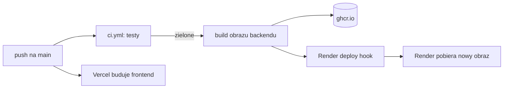

# CI/CD: testy i deploy

Każda zmiana w kodzie przechodzi przez te same automatyczne testy, zanim trafi na produkcję. Ten dokument opisuje, co dokładnie sprawdza GitHub Actions i jak zmiana z `main` ląduje na serwerze.

## Co sprawdza CI

Workflow [`ci.yml`](../.github/workflows/ci.yml) odpala się przy każdym pull requeście i każdym pushu na branch inny niż `main`. Ma dwa niezależne joby.

Job **backend** instaluje zależności przez `uv sync --frozen` (czyli dokładnie wersje z `uv.lock`) i uruchamia całe `pytest`. Obok kontenera z testami GitHub stawia prawdziwego PostgreSQL 16 na porcie 55432, więc testy integracyjne (oznaczone markerem `integration`) aplikują migracje i wykonują prawdziwe zapytania SQL, a nie tylko mocki. Testy integracyjne włącza zmienna `RUN_DB_TESTS=1`; lokalnie bez niej są pomijane.

Job **frontend** robi `npm ci` i `npm run build`. Lint (`npm run lint`) też się uruchamia, ale na razie nie blokuje — w kodzie z czasów Mundialu jest kilkanaście starych błędów reguł `react-hooks`. Gdy zostaną poprawione, wystarczy usunąć `continue-on-error: true` z kroku Lint.

## Jak działa deploy

Produkcja to trzy usługi: frontend na Vercelu, backend na Render.com (kontener Dockera), baza na Neon. Pod adresem `www.czutka.uk` odpowiada Vercel, który ścieżki `/api/*` przekazuje do backendu na Renderze (reguła `rewrites` w [`vercel.json`](../mundial-frontend/vercel.json)). Dzięki temu przeglądarka widzi jeden adres i ciasteczko z sesją działa bez kombinowania z CORS.

Backend deployuje [`deploy-backend.yml`](../.github/workflows/deploy-backend.yml), uruchamiany przy pushu na `main`, który zmienia coś w `mundial-backend/`. Najpierw wywołuje `ci.yml` jako krok `ci` — jeśli testy nie przejdą, deploy się nie zacznie. Potem buduje obraz, publikuje go w GitHub Container Registry z tagami `latest` i SHA commita, a na końcu woła deploy hook Rendera (sekret `RENDER_DEPLOY_HOOK`), żeby Render pobrał nowy obraz. Migracje bazy aplikuje sam backend przy starcie.

Frontend buduje i publikuje Vercel automatycznie po pushu na `main` — to integracja po stronie Vercela, nie workflow w repo.

## Sekrety

W ustawieniach repozytorium na GitHubie potrzebny jest tylko `RENDER_DEPLOY_HOOK`. Do ghcr.io workflow loguje się wbudowanym `GITHUB_TOKEN`. Zmienne środowiskowe backendu (hasło do bazy, klucze API) ustawia się w panelu Rendera, nigdy w repo.

## Azure

W historii repo był krok deployu do Azure Container Apps, ale został usunięty (brak uprawnień service principala). Produkcja nie działa na Azure. Przeniesienie jest odłożone na później.
