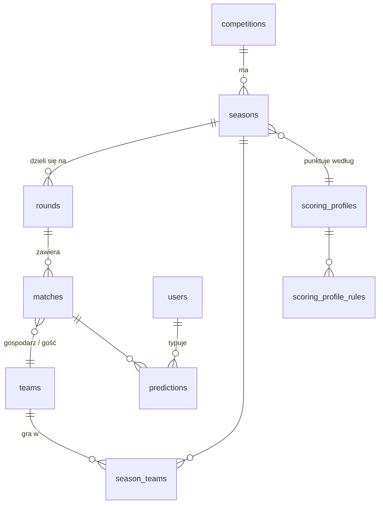

# Model danych

Ten dokument wyjaśnia, jak baza przechowuje rozgrywki, mecze i typy. Najważniejsza zmiana względem wersji mundialowej: zamiast jednego turnieju na sztywno mamy hierarchię **rozgrywka → sezon → runda → mecz**, dzięki której ta sama aplikacja obsługuje ligę (34 kolejki), puchar z fazą ligową (Liga Mistrzów) i turniej reprezentacji (Mundial).

Schemat tworzą migracje w [`mundial-backend/db/migrations/`](../mundial-backend/db/migrations/); jak je uruchamiać, opisuje [migrations.md](migrations.md).

## Hierarchia rozgrywek

**`competitions`** to rozgrywka jako taka: „Liga Mistrzów”, „Premier League”, „Mistrzostwa Świata”. Każda ma krótki kod (`UCL`, `EPL`, `WC`…), rodzaj (`league`, `cup`, `national_cup`), dostawcę danych (`provider`, np. `football-data`) i identyfikator rozgrywki u tego dostawcy (`provider_ref`, np. `CL`). Flaga `is_active` mówi, czy rozgrywka jest synchronizowana i widoczna do typowania. Ekstraklasa i Liga Narodów są w tabeli, ale nieaktywne i bez dostawcy — nie ma dla nich darmowego źródła danych (szczegóły w [data-source.md](data-source.md)).

**`seasons`** to jedna edycja rozgrywki: „Liga Mistrzów 2026/27”, „Mundial 2026”. Sezon ma status `upcoming`, `active` albo `archived` i wskazuje profil punktacji. Rankingi liczą się per sezon, więc nowy sezon to czysta karta, a stary zostaje do wglądu jako archiwum.

**`rounds`** to kolejka albo faza wewnątrz sezonu. Pole `phase` ma ustalony słownik (`regular`, `league_phase`, `group`, `playoff`, `round_of_32`, `round_of_16`, `quarter`, `semi`, `third_place`, `final`, `other`), a `matchday` numer kolejki, jeśli faza go ma. Kolejka 12 Premier League to `phase='regular', matchday=12`; ćwierćfinał Ligi Mistrzów to `phase='quarter', matchday=NULL`. `name` trzyma gotową polską nazwę („Kolejka 12”, „Ćwierćfinał”), więc frontend nie musi niczego tłumaczyć. Para (sezon, faza, kolejka) jest unikalna także wtedy, gdy kolejka jest pusta (`UNIQUE NULLS NOT DISTINCT`).

Dlaczego osobna tabela rund zamiast kolumny w meczu? Bo rundy mają własne dane (nazwa, kolejność wyświetlania), a faza decyduje o punktacji. Gdyby siedziała jako tekst w każdym meczu, każda rozgrywka wymagałaby osobnego słownika w kodzie frontu — dokładnie ten problem miała wersja mundialowa.

**`teams`** to drużyny — kluby i reprezentacje. Jedna drużyna może grać w kilku rozgrywkach naraz (Real Madryt w LaLiga i Lidze Mistrzów), dlatego przynależność do sezonu trzyma osobna tabela **`season_teams`** (razem z grupą, jeśli rozgrywka ją ma). Identyfikator u dostawcy jest unikalny w parze `(provider, external_id)`, żeby w przyszłości dało się dodać drugie źródło danych bez kolizji numerów.

## Mecz i jego wynik

Mecz (`matches`) należy do sezonu i rundy, ma datę rozpoczęcia w UTC (`kickoff_at`) i status:

| Status | Znaczenie | Typowanie |
|---|---|---|
| `scheduled` | zaplanowany | otwarte, dopóki `kickoff_at` jest w przyszłości |
| `live` | trwa | zamknięte |
| `finished` | zakończony | zamknięte, typy są punktowane |
| `postponed`, `suspended` | przełożony / przerwany | zamknięte, otwiera się znowu po wyznaczeniu nowego terminu |
| `cancelled`, `awarded` | odwołany / walkower | typy unieważnione, nie liczą się do rankingu |

`kickoff_confirmed = false` oznacza, że godzina jest jeszcze orientacyjna (dostawca podał tylko dzień).

Wynik jest rozbity na części, bo punktujemy **wynik po 90 minutach** (z doliczonym czasem), a dogrywka i karne nie mają znaczenia dla typu. `home_goals`/`away_goals` to wynik po 90 minutach dla zakończonego meczu (a w trakcie meczu — bieżący wynik). Osobno trzymamy wynik po dogrywce (`home_goals_et`/`away_goals_et`), rzuty karne (`home_pens`/`away_pens`) i sposób rozstrzygnięcia (`decided_by`: `regular`, `extra_time`, `penalties`). Przykład: finał 0:0 po 90 minutach, 1:0 po dogrywce zapisuje się jako `home_goals=0, away_goals=0, home_goals_et=1, away_goals_et=0, decided_by='extra_time'` — kto typował 0:0, trafił dokładny wynik.

`scored_at` to moment naliczenia punktów, a `last_synced_at` — ostatnia aktualizacja z API. Dla archiwalnych sezonów `scored_at` = `kickoff_at` (migracja 006), więc ich wyniki nie są już ponownie przeliczane.

## Typy i punkty

Tabela `predictions` się nie zmieniła: jeden typ na użytkownika na mecz (`UNIQUE (user_id, match_id)`), punkty w `points_awarded` (puste, dopóki mecz nie jest rozliczony). Doszła kolumna `hit_type` (`exact`, `diff`, `tendency`, `miss`) — który próg punktacji został trafiony. Dzięki niej frontend nie musi zgadywać kategorii z liczby punktów, a ranking może rozstrzygać remisy liczbą dokładnych trafień.

Ile punktów daje dany próg, mówi **profil punktacji**. `scoring_profiles` to nazwane zestawy, a `scoring_profile_rules` to punkty per faza, z wierszem `default` jako zapasem dla faz bez własnego wiersza:

| Profil | Używany przez | Punkty (dokładny / różnica / wynik) |
|---|---|---|
| `league_default` | ligi | 5 / 3 / 2 w każdej kolejce |
| `uefa_cup` | Liga Mistrzów, Liga Narodów | 5/3/2 w fazie ligowej i barażach, potem rośnie: 1/8 7/4/3, ćwierćfinał 9/5/4, półfinał 11/6/5, finał 15/8/6 |
| `wc2026` | archiwum Mundialu | dokładna kopia dawnej tabeli `scoring_rules` |

Sama logika liczenia jest w czystych funkcjach w `domain/scoring.py` — opis zasad w [scoring.md](scoring.md).

## Użytkownicy, obserwowane rozgrywki i ligi prywatne

`user_competitions` zapisuje, które rozgrywki użytkownik obserwuje (filtr listy meczów). Ligi prywatne (`private_leagues`, `private_league_members`) działają jak wcześniej — kod zaproszenia, członkowie, ranking. Nowa tabela `private_league_competitions` pozwala zawęzić ligę do wybranych rozgrywek (brak wierszy = wszystkie).

Bonusy są teraz opcją ligi prywatnej: właściciel dodaje pytanie bonusowe (`league_bonus_questions`, na razie rodzaj `champion` — „kto wygra sezon”) z liczbą punktów i terminem, a członkowie odpowiadają w `league_bonus_answers`. Punkty z bonusów liczą się tylko w rankingu tej ligi.

## Synchronizacja

`sync_runs` to dziennik każdego przebiegu synchronizacji z API: rodzaj, rozgrywka, czas, liczba zapytań, ile meczów zaktualizowano i rozliczono, ewentualny błąd. Służy do podglądu w panelu admina i do pilnowania limitu zapytań darmowego planu. Wiersz o statusie `running` jest jednocześnie blokadą: unikalny indeks częściowy (migracja 007) dopuszcza tylko jeden taki wiersz naraz. Jak działa synchronizacja, opisuje [data-source.md](data-source.md#synchronizacja).

## Mundial 2026 jako archiwum

Dane z Mundialu zostały przeniesione do nowego modelu bez zmiany ani jednego punktu: rozgrywka `WC`, sezon `2026` ze statusem `archived`, siedem rund (od fazy grupowej po finał), drużyny w `season_teams` z grupami, `hit_type` wyliczony z zapisanych wyników. Stare globalne bonusy (mistrz, awanse z grup) dostały `season_id` Mundialu i zostają jako archiwum tylko do odczytu.

Kilka kolumn i tabel z wersji mundialowej jeszcze istnieje, bo część kodu z nich korzysta: `leagues`, `scoring_rules`, `matches.stage`, `matches.league_id`, `teams.league_id`, `teams.group_name`. Usunie je osobna migracja, gdy żaden kod nie będzie ich czytał (wzorzec „expand → contract”, opisany w [migrations.md](migrations.md)).
