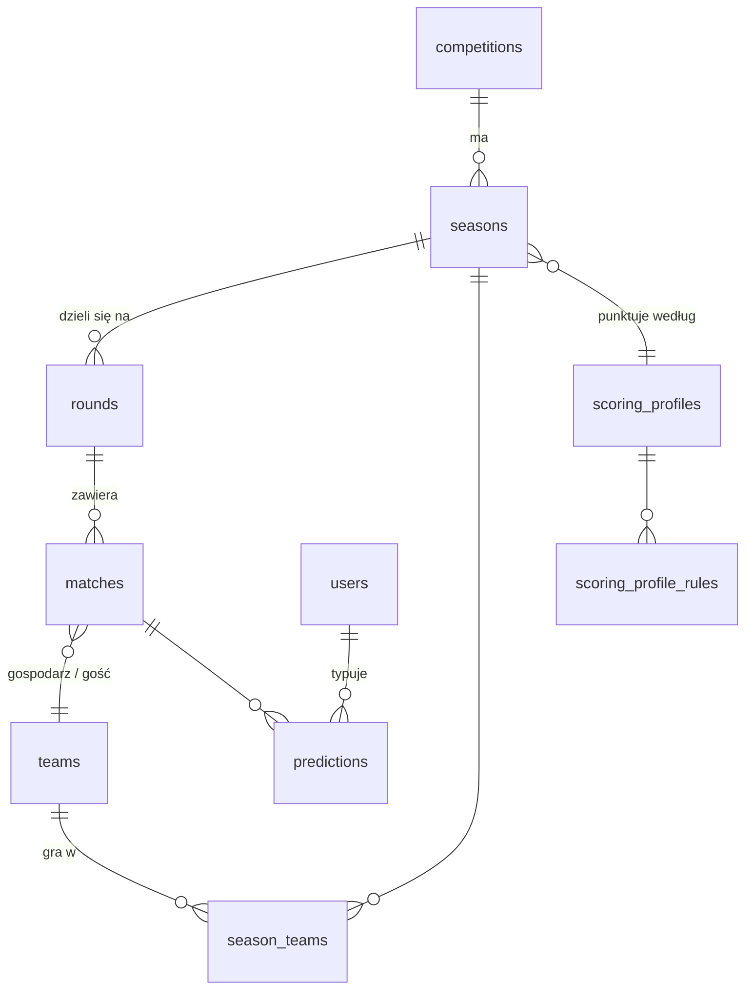

# Model danych

Ten dokument wyjaśnia, jak baza przechowuje rozgrywki, mecze i typy. Najważniejsza zmiana względem wersji mundialowej: zamiast jednego turnieju na sztywno mamy hierarchię **rozgrywka → sezon → runda → mecz**, dzięki której ta sama aplikacja obsługuje ligę (34 kolejki), puchar z fazą ligową (Liga Mistrzów) i turniej reprezentacji (Mundial).

Schemat tworzą migracje w [`mundial-backend/db/migrations/`](../mundial-backend/db/migrations/); jak je uruchamiać, opisuje [migrations.md](migrations.md).

## Hierarchia rozgrywek

**`competitions`** to rozgrywka jako taka: „Liga Mistrzów”, „Premier League”, „Mistrzostwa Świata”. Każda ma krótki kod (`UCL`, `EPL`, `WC`…), rodzaj (`league`, `cup`, `national_cup`), dostawcę danych (`provider`, np. `football-data`) i identyfikator rozgrywki u tego dostawcy (`provider_ref`, np. `CL`). Flaga `is_active` mówi, czy rozgrywka jest synchronizowana i widoczna do typowania. Ekstraklasa i Liga Narodów są w tabeli, ale nieaktywne i bez dostawcy — nie ma dla nich darmowego źródła danych (szczegóły w [data-source.md](data-source.md)).

**`seasons`** to jedna edycja rozgrywki: „Liga Mistrzów 2026/27”, „Mundial 2026”. Sezon ma status `upcoming`, `active` albo `archived` i wskazuje profil punktacji. Rankingi liczą się per sezon, więc nowy sezon to czysta karta, a stary zostaje do wglądu jako archiwum.

**`rounds`** to kolejka albo faza wewnątrz sezonu. Pole `phase` ma ustalony słownik (`regular`, `league_phase`, `group`, `playoff`, `round_of_32`, `round_of_16`, `quarter`, `semi`, `third_place`, `final`, `other`), a `matchday` numer kolejki, jeśli faza go ma. Kolejka 12 Premier League to `phase='regular', matchday=12`; ćwierćfinał Ligi Mistrzów to `phase='quarter', matchday=NULL`. `name` trzyma gotową polską nazwę („Kolejka 12”, „Ćwierćfinał”), więc frontend nie musi niczego tłumaczyć. Para (sezon, faza, kolejka) jest unikalna także wtedy, gdy kolejka jest pusta (`UNIQUE NULLS NOT DISTINCT`).

Dlaczego osobna tabela rund zamiast kolumny w meczu? Bo rundy mają własne dane (nazwa, kolejność wyświetlania), a faza decyduje o punktacji. Gdyby siedziała jako tekst w każdym meczu, każda rozgrywka wymagałaby osobnego słownika w kodzie frontu — dokładnie ten problem miała wersja mundialowa.

**`teams`** to drużyny — kluby i reprezentacje. Jedna drużyna może grać w kilku rozgrywkach naraz (Real Madryt w LaLiga i Lidze Mistrzów), dlatego przynależność do sezonu trzyma osobna tabela **`season_teams`** (razem z grupą, jeśli rozgrywka ją ma). Identyfikator u dostawcy jest unikalny w parze `(provider, external_id)`, żeby w przyszłości dało się dodać drugie źródło danych bez kolizji numerów.

## Mecz i jego wynik

Mecz (`matches`) należy do sezonu i rundy, ma datę rozpoczęcia w UTC (`kickoff_at`) i status:

| Status | Znaczenie | Typowanie |
|---|---|---|
| `scheduled` | zaplanowany | otwarte, dopóki `kickoff_at` jest w przyszłości |
| `live` | trwa | zamknięte |
| `finished` | zakończony | zamknięte, typy są punktowane |
| `postponed`, `suspended` | przełożony / przerwany | zamknięte, otwiera się znowu po wyznaczeniu nowego terminu |
| `cancelled`, `awarded` | odwołany / walkower | typy unieważnione, nie liczą się do rankingu |

`kickoff_confirmed = false` oznacza, że godzina jest jeszcze orientacyjna (dostawca podał tylko dzień).

Wynik jest rozbity na części, bo punktujemy **wynik po 90 minutach** (z doliczonym czasem), a dogrywka i karne nie mają znaczenia dla typu. `home_goals`/`away_goals` to wynik po 90 minutach dla zakończonego meczu (a w trakcie meczu — bieżący wynik). Osobno trzymamy wynik po dogrywce (`home_goals_et`/`away_goals_et`), rzuty karne (`home_pens`/`away_pens`) i sposób rozstrzygnięcia (`decided_by`: `regular`, `extra_time`, `penalties`). Przykład: finał 0:0 po 90 minutach, 1:0 po dogrywce zapisuje się jako `home_goals=0, away_goals=0, home_goals_et=1, away_goals_et=0, decided_by='extra_time'` — kto typował 0:0, trafił dokładny wynik.

`scored_at` to moment naliczenia punktów, a `last_synced_at` — ostatnia aktualizacja z API. Dla archiwalnych sezonów `scored_at` = `kickoff_at` (migracja 006), więc ich wyniki nie są już ponownie przeliczane.

## Typy i punkty

Tabela `predictions` się nie zmieniła: jeden typ na użytkownika na mecz (`UNIQUE (user_id, match_id)`), punkty w `points_awarded` (puste, dopóki mecz nie jest rozliczony). Doszła kolumna `hit_type` (`exact`, `diff`, `tendency`, `miss`) — który próg punktacji został trafiony. Dzięki niej frontend nie musi zgadywać kategorii z liczby punktów, a ranking może rozstrzygać remisy liczbą dokładnych trafień.

Ile punktów daje dany próg, mówi **profil punktacji**. `scoring_profiles` to nazwane zestawy, a `scoring_profile_rules` to punkty per faza, z wierszem `default` jako zapasem dla faz bez własnego wiersza:

| Profil | Używany przez | Punkty (dokładny / różnica / wynik) |
|---|---|---|
| `league_default` | ligi | 5 / 3 / 2 w każdej kolejce |
| `uefa_cup` | Liga Mistrzów, Liga Narodów | 5/3/2 w fazie ligowej i barażach, potem rośnie: 1/8 7/4/3, ćwierćfinał 9/5/4, półfinał 11/6/5, finał 15/8/6 |
| `wc2026` | archiwum Mundialu | dokładna kopia dawnej tabeli `scoring_rules` |

Sama logika liczenia jest w czystych funkcjach w `domain/scoring.py` — opis zasad w [scoring.md](scoring.md).

## Użytkownicy, ligi prywatne i „moje rozgrywki”

Ligi prywatne (`private_leagues`, `private_league_members`) działają jak wcześniej — kod zaproszenia, członkowie, ranking. Tabela `private_league_competitions` pozwala zawęzić ligę do wybranych rozgrywek (brak wierszy = wszystkie aktywne).

**Moje rozgrywki** (od 10.11.2026, [decisions.md](decisions.md) #014) nie są nigdzie zapisane, liczymy je w zapytaniu: suma zakresów wszystkich moich lig. Liga bez wierszy w `private_league_competitions` wnosi wszystkie aktywne rozgrywki, jawny zakres liczy się także dla rozgrywki nieaktywnej. Gracz bez żadnej ligi ma wszystkie aktywne rozgrywki (z tej samej puli dobiera mecze kupon ogólny). Z tej reguły korzystają `GET /feed`, `GET /me/upcoming-matches` i flaga `in_my_leagues` w `GET /competitions` (fragmenty SQL `_SQL_IN_MY_LEAGUES` i `_SQL_MY_COMPETITIONS` w `db/queries/competitions.py`).

`user_competitions` (dawne „Obserwuj”) zostaje w bazie, ale **nikt jej już nie czyta ani nie zapisuje**: dołączenie do ligi i zmiana zakresu nie dopisują tam rozgrywek, a `POST`/`DELETE /competitions/{id}/follow` nic nie robią. Wiersze z czasów obserwowania (także te z jednorazowej migracji 012) leżą nietknięte. Tabelę usunie późniejsza migracja contract.

Bonusy są teraz opcją ligi prywatnej: właściciel dodaje pytanie bonusowe (`league_bonus_questions`) z liczbą punktów i terminem, a członkowie odpowiadają w `league_bonus_answers`. Punkty z bonusów liczą się tylko w rankingu tej ligi.

Rodzaje pytań: `champion` („kto wygra sezon”, rozstrzyga synchronizacja albo admin aplikacji przez `resolved_team_id`, jedno na sezon w lidze — częściowy indeks unikalny `uq_league_bonus_questions_champion`) i od migracji 010 `team_pick` — własne pytanie o drużyny sezonu z treścią w `title` (np. „Kto spadnie z Premier League?”) i `answers_count` (1–10, ile drużyn wybiera gracz; dla `champion` zawsze 1). Odpowiedź gracza to **jeden wiersz na wybraną drużynę** (`PRIMARY KEY (question_id, user_id, team_id)`), a `points_awarded` każdego wiersza to punkty za tę drużynę — suma wierszy daje punkty gracza, więc zapytania rankingów się nie zmieniły. Poprawne drużyny pytania `team_pick` zaznacza właściciel po terminie w **`league_bonus_correct_teams`** (`question_id`, `team_id`; od 1 do `answers_count` drużyn) i wtedy ustawia się `resolved_at`.

## Kupon tygodnia

Migracja 008 (`008_league_coupons.sql`, rollback w `rollback/008_league_coupons.down.sql`). Liga prywatna dostała trzy ustawienia: `ranking_mode` (`scope` — ranking liczy wszystkie mecze z zakresu ligi; `coupon` — tylko mecze z kuponów tej ligi), `coupon_size` (5–15, domyślnie 10; od 013 tylko rozmiar zapasu dla ligi z wąskim zakresem) i `coupon_auto` (czy liga co tydzień dostaje kopię kuponu ogólnego).

**Od migracji 016** (`016_coupon_ranking_only.sql`, rollback w `rollback/016_coupon_ranking_only.down.sql`, [decisions.md](decisions.md) #014) każda liga ma `ranking_mode = 'coupon'`: migracja przestawiła wszystkie ligi, domyślna wartość kolumny to `coupon`, a `POST /leagues` sam zapisuje `coupon` (`domain.leagues.LEAGUE_RANKING_MODE`). Dotychczasową wartość lig, które się zmieniły, trzyma **`league_ranking_mode_backup`** (`private_league_id` PK z `ON DELETE CASCADE`, `ranking_mode`, `saved_at`) — rollback przywraca z niej `scope`, ustawia domyślne `scope` i usuwa tabelę; ligi założone po 016 zostają `coupon`. `CHECK` nadal dopuszcza `scope`, kolumnę (i tabelę kopii) usunie migracja contract. Sezony `archived` (Mundial) nie mają kuponów, więc dla nich ranking, odznaki, tabela na żywo i typy gracza liczą wszystkie mecze — decyduje o tym kod (`domain.leagues.effective_ranking_mode`), nie kolumna.

**`weekly_coupons`** (migracja 013, rollback w `rollback/013_global_weekly_coupon.down.sql`) to jeden **kupon ogólny** na tydzień dla wszystkich („hity tygodnia”): `id`, `week_start` (poniedziałek, data polska, `UNIQUE` — generowanie w locie i w schedulerze jest idempotentne), `created_at`. **`weekly_coupon_matches`** to jego mecze: `coupon_id`, `match_id`, `is_hit` (`FALSE` = mecz dobrany, bo hitów było mniej niż 6), `added_at`, `PRIMARY KEY (coupon_id, match_id)`, indeks po `match_id`. Raz zrobiony kupon ogólny się nie zmienia. Co jest hitem: `domain/coupon_hits.py` i spec kuponu.

**`league_coupons`** to jeden kupon ligi na tydzień — zmaterializowana lista meczów ligi, na niej działają ranking w trybie `coupon`, jokery i reakcje. `week_start` to poniedziałek (data polska), `created_by` mówi, skąd są mecze: `global` (kopia kuponu ogólnego z zakresu ligi, od migracji 013), `owner` (zmienił organizator), `auto` (automat ligi — zapas, gdy z zakresu zostaje mniej niż 5 hitów, albo stary `regenerate`). Rollback 013 zamienia `global` na `auto`. `UNIQUE (private_league_id, week_start)` sprawia, że automat odpalony dwa razy nie zrobi dwóch kuponów. **`league_coupon_matches`** to mecze na kuponie (`PRIMARY KEY (coupon_id, match_id)`, indeks po `match_id`). Typy się nie zmieniły — nadal jeden typ na użytkownika i mecz w `predictions`, więc mecz z dwóch kuponów typuje się raz. Tydzień bez meczów nie ma wiersza kuponu.

**`league_coupon_jokers`** (migracja 010) to joker członka na kuponie: `coupon_id`, `user_id`, `match_id`, `set_at`, `PRIMARY KEY (coupon_id, user_id)` — jeden joker na osobę i tydzień. Klucz obcy `(coupon_id, match_id)` wskazuje na `league_coupon_matches`, więc mecz usunięty z kuponu zabiera jokera ze sobą. Punkty meczu z jokerem liczą się ×2 w rankingu ligi w trybie `coupon` (od 016 każda liga, poza sezonami archiwalnymi) i w wynikach tygodnia; `predictions.points_awarded` się nie zmienia.

**`league_pick_reactions`** (migracja 011) to emoji pod typem kolegi z ligi: `private_league_id`, `match_id`, `target_user_id` (autor typu), `user_id` (kto reaguje), `emoji`, `reacted_at`, `PRIMARY KEY (private_league_id, match_id, target_user_id, user_id)` — jedna reakcja na osobę i typ, nowe emoji ją nadpisuje. `CHECK (user_id <> target_user_id)` (bez reakcji na własny typ). Obaj muszą być członkami ligi: dwa klucze obce do `private_league_members (private_league_id, user_id)` z `ON DELETE CASCADE`, więc wyjście z ligi zabiera reakcje danej osoby i reakcje pod jej typami. Zestaw emoji (🔥 😂 🤡 👏 😱 🙈) pilnuje `domain/reactions.py`, baza tylko ogranicza długość. Reagować można dopiero po starcie meczu z kuponu ligi (router).

Tabeli ligowej nie trzymamy: miejsca drużyn do doboru meczów liczymy w locie z zakończonych meczów sezonu (fazy `regular`/`league_phase`, 3/1/0, potem bilans i bramki — `domain.coupon.league_table`), a przed trzecią kolejką miejsc nie ma. Do kuponu ogólnego drużyna z Ligi Mistrzów dostaje miejsce w tabeli swojej ligi krajowej (sezon z `season_teams` w rozgrywkach `kind = 'league'`, nie archiwalny).

## Logo rozgrywek

`competitions.logo_url` (kolumna od migracji 005) trzyma `emblem` rozgrywki z football-data. Przebieg `season` zapisuje go przy okazji `GET /competitions/{code}`, które i tak pobiera bieżący sezon, więc nie kosztuje dodatkowego zapytania; zapis następuje tylko, gdy wartość się zmieniła. Migracja 009 (`009_competition_logos.sql`, rollback w `rollback/009_competition_logos.down.sql`) jednorazowo uzupełnia logo rozgrywek football-data (`provider_ref` CL, PL, PD, SA, BL1, FL1 → `https://crests.football-data.org/{provider_ref}.png`, a WC → `wm26.png`, bo `WC.png` nie istnieje) tam, gdzie było NULL. Same obrazki front ładuje przez proxy `GET /img/crest` ([api-contract.md](api-contract.md#obrazki--proxy-herbów)).

## Synchronizacja

`sync_runs` to dziennik każdego przebiegu synchronizacji z API: rodzaj, rozgrywka, czas, liczba zapytań, ile meczów zaktualizowano i rozliczono, ewentualny błąd. Służy do podglądu w panelu admina i do pilnowania limitu zapytań darmowego planu. Wiersz o statusie `running` jest jednocześnie blokadą: unikalny indeks częściowy (migracja 007) dopuszcza tylko jeden taki wiersz naraz. Jak działa synchronizacja, opisuje [data-source.md](data-source.md#synchronizacja).

## Mundial 2026 jako archiwum

Dane z Mundialu zostały przeniesione do nowego modelu bez zmiany ani jednego punktu: rozgrywka `WC`, sezon `2026` ze statusem `archived`, siedem rund (od fazy grupowej po finał), drużyny w `season_teams` z grupami, `hit_type` wyliczony z zapisanych wyników. Stare globalne bonusy (mistrz, awanse z grup) dostały `season_id` Mundialu i zostają jako archiwum tylko do odczytu.

Kilka kolumn i tabel z wersji mundialowej jeszcze istnieje, bo część kodu z nich korzysta: `leagues`, `scoring_rules`, `matches.stage`, `matches.league_id`, `teams.league_id`, `teams.group_name`. Usunie je osobna migracja, gdy żaden kod nie będzie ich czytał (wzorzec „expand → contract”, opisany w [migrations.md](migrations.md)).
