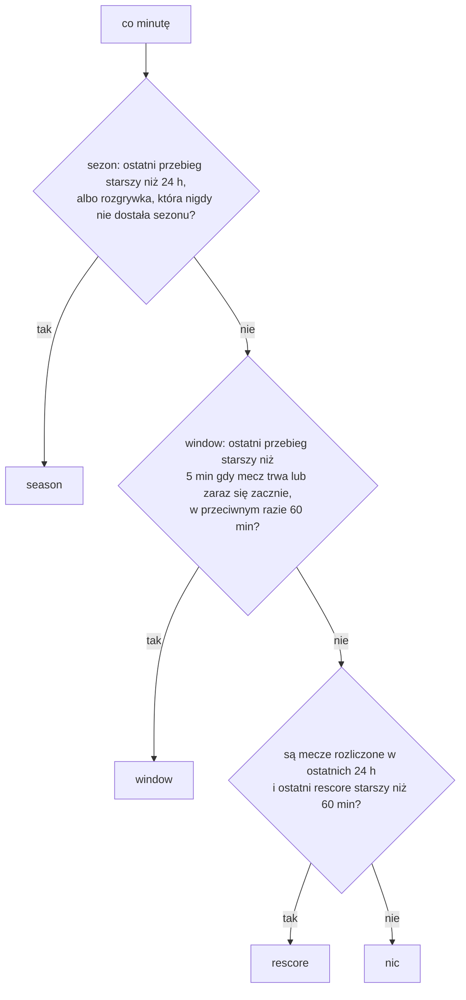

# Źródło danych meczowych

Terminarz, wyniki i drużyny pobieramy automatycznie z zewnętrznego API. Ten dokument wyjaśnia, które API wybraliśmy i dlaczego, czego ono nie obejmuje oraz jak kod tłumaczy jego dane na nasz model.

## Dlaczego football-data.org

Założenie projektu to zero kosztów stałych, więc szukaliśmy darmowego źródła, które pokryje Ligę Mistrzów, Ekstraklasę, Ligę Narodów i ligi top 5. Takiego źródła nie ma. Porównaliśmy:

- **football-data.org, plan darmowy** — Liga Mistrzów, Premier League, LaLiga, Serie A, Bundesliga, Ligue 1 (plus Championship, Eredivisie, Primeira Liga, Brasileirão, Euro, Mundial). Limit 10 zapytań na minutę, wyniki z opóźnieniem. Brak Ekstraklasy i Ligi Narodów.
- **API-Football** — obejmuje wszystko, ale darmowy plan nie daje dostępu do bieżącego sezonu; najtańszy płatny to ok. 19 USD/mies.
- **TheSportsDB** — ma Ekstraklasę, ale darmowy klucz zwraca tylko kilka meczów sezonu; pełne dane za ok. 9 USD/mies.
- **Nieoficjalne API ESPN** — nieudokumentowane, bez gwarancji, a dla Ekstraklasy zwraca błąd.

Wybraliśmy football-data.org, bo za darmo pokrywa 6 z 8 docelowych rozgrywek, ma przewidywalny limit i porządną dokumentację, a dane Mundialu i tak pochodziły z tego źródła. Ekstraklasa i Liga Narodów są w bazie jako nieaktywne rozgrywki bez dostawcy. Kod jest przygotowany na drugiego dostawcę, więc włączenie ich później to dopisanie adaptera i jedna zmiana w tabeli `competitions` (decyzja w [decisions.md](decisions.md), wpis 010).

Klucz API ustawia się w zmiennej środowiskowej `FOOTBALL_API_KEY` — nigdy w kodzie.

## Warstwa dostawcy

Kod komunikacji z API mieszka w [`services/providers/`](../mundial-backend/services/providers/). `base.py` definiuje wspólny interfejs `FootballProvider` i neutralne struktury danych (`ProviderMatch`, `ProviderTeam`, `ProviderSeason`) — reszta aplikacji zna tylko je, nie format konkretnego API. `football_data.py` to implementacja dla football-data.org, a `registry.py` zwraca dostawcę po nazwie zapisanej w `competitions.provider`.

Interfejs ma cztery operacje: bieżący sezon rozgrywki (razem z drużyną-zwycięzcą, gdy sezon jest rozstrzygnięty), wszystkie mecze sezonu, mecze z okna dat (dla wielu rozgrywek naraz — jedno zapytanie zamiast sześciu) i mecze po identyfikatorach. Dostawca liczy też swoje zapytania (`requests_made`), z czego synchronizacja wylicza `requests_used` w `sync_runs`.

`football_data.py` jest podzielony na dwie części. Czyste funkcje tłumaczą odpowiedź API na nasz model i są testowane na nagranych prawdziwych odpowiedziach (`tests/fixtures/providers/football_data/`), bez sieci. Klient HTTP pilnuje limitu: czyta nagłówki `X-Requests-Available-Minute` i `X-RequestCounter-Reset`, czeka, gdy limit się wyczerpie, a przy błędzie 429 lub 5xx ponawia zapytanie do trzech razy z rosnącą przerwą. Długie okna dat dzieli na kawałki po 10 dni (limit API).

## Jak tłumaczymy dane

Statusy: `SCHEDULED` i `TIMED` → `scheduled` (przy `SCHEDULED` godzina nie jest jeszcze potwierdzona), `IN_PLAY`, `PAUSED`, `EXTRA_TIME`, `PENALTY_SHOOTOUT` → `live`, a `FINISHED`, `POSTPONED`, `SUSPENDED`, `CANCELLED`, `AWARDED` → odpowiednio `finished`, `postponed`, `suspended`, `cancelled`, `awarded`.

Fazy: `REGULAR_SEASON` → `regular`, `LEAGUE_STAGE` → `league_phase`, `GROUP_STAGE` → `group`, warianty baraży → `playoff`, `LAST_32`/`LAST_16` → `round_of_32`/`round_of_16`, `QUARTER_FINALS`, `SEMI_FINALS`, `THIRD_PLACE`, `FINAL` → odpowiednio `quarter`, `semi`, `third_place`, `final`. Nieznana faza trafia do `other` z ostrzeżeniem w logach. Nazwy rund powstają po polsku: „Kolejka 12”, „Faza ligowa – kolejka 3”, „Ćwierćfinał”.

Nazwy reprezentacji tłumaczymy na polski (`services/translations.py`), nazwy klubów zostają oryginalne.

### Wynik a dogrywka i karne

To najważniejsza pułapka tego API. Pole `score.fullTime` **zawiera gole z dogrywki i z serii rzutów karnych**. Przykład z Mundialu 2026, Niemcy – Paragwaj w 1/16 finału:

```json
{"duration": "PENALTY_SHOOTOUT",
 "fullTime":    {"home": 4, "away": 5},
 "regularTime": {"home": 1, "away": 1},
 "extraTime":   {"home": 0, "away": 0},
 "penalties":   {"home": 3, "away": 4}}
```

Mecz skończył się 1:1, a `fullTime` mówi 4:5. Dlatego wynik do punktacji bierzemy z `regularTime`, gdy mecz miał dogrywkę lub karne, a z `fullTime` tylko przy `duration = REGULAR`. Wynik po dogrywce to `regularTime + extraTime` (bo `extraTime` to same gole z dogrywki), a karne zapisujemy osobno.

Stara wersja aplikacji zapisywała `fullTime`, więc 9 meczów pucharowych Mundialu (4 z karnymi, 5 z dogrywką) mogło zostać zapisanych i rozliczonych z zawyżonym wynikiem. Archiwum nie jest przeliczane automatycznie; to, czy je poprawić, jest osobną decyzją.

## Synchronizacja

Dane z API trafiają do bazy przez zadanie w tle: [`services/sync.py`](../mundial-backend/services/sync.py) wykonuje pracę, a czyste decyzje (co zrobić z jednym meczem, kiedy uruchomić który przebieg, kto jest mistrzem) siedzą w [`domain/sync_plan.py`](../mundial-backend/domain/sync_plan.py), więc da się je testować bez bazy i sieci. Zadanie startuje razem z backendem (`main.py`), działa w osobnym wątku i nigdy nie wywraca aplikacji — błąd ląduje w logu i w tabeli `sync_runs`. Wyłączysz je zmienną `SYNC_ENABLED=false`; bez `FOOTBALL_API_KEY` też się nie włączy. Synchronizacja dotyczy tylko rozgrywek z `is_active = true` i dostawcą — nieaktywny Mundial, Ekstraklasa i Liga Narodów są pomijane, a sezony ze statusem `archived` (dziś archiwum Mundialu) nie są nigdy dotykane.

### Trzy rodzaje przebiegów

| Przebieg | Co robi | Zapytań do API |
|---|---|---|
| `season` | dla każdej aktywnej rozgrywki: bieżący sezon, a potem wszystkie jego mecze (drużyny, rundy, mecze) | 2 na rozgrywkę |
| `window` | mecze z kilku dni wokół dziś, wszystkie aktywne rozgrywki jednym zapytaniem | 1 |
| `rescore` | mecze rozliczone w ostatnich 24 godzinach — czy dostawca nie poprawił wyniku | 1 na 50 meczów |

Każdy przebieg zapisuje wiersz w `sync_runs` (rodzaj, rozgrywka, czas, liczba zapytań, ile meczów zapisano i rozliczono, błąd). Panel admina pokazuje je w `GET /admin/sync/runs`, a przebieg można wywołać ręcznie przez `POST /admin/sync/run` ([api-contract.md](api-contract.md)). Przebieg `season` dla wszystkich sześciu rozgrywek to 12 zapytań, więc limit 10 na minutę zatrzymuje go na minutę lub dwie — ręczne wywołanie wraca dopiero po zakończeniu.

### Harmonogram

Co minutę zadanie czyta ostatnie przebiegi z `sync_runs` i decyduje, czy coś jest należne. Historia siedzi w bazie, nie w pamięci, więc restart backendu (częsty na darmowym Renderze) nie powtarza dobowej synchronizacji sezonu.



W jednym kroku idzie najwyżej jeden przebieg. „Mecz trwa lub zaraz się zacznie” to mecz `live` albo niezakończony mecz z godziną rozpoczęcia od 3 godzin temu do 15 minut w przód. W takim trybie okno dat to [wczoraj, za 2 dni], poza nim [wczoraj, za 7 dni] (dłuższe niż 10 dni dzieli provider). Nieudany przebieg jest ponawiany szybciej niż normalny interwał, ale coraz wolniej: czekanie podwaja się po każdej kolejnej porażce tego rodzaju z rzędu i ma sufit. `season` ponawia po 15, 30, 60, 120, 240 minut, a potem co 6 godzin (`rescore` zaczyna od 60 minut, też do 6 godzin), `window` zaczyna od swojego interwału (5 albo 60 minut) i nie czeka dłużej niż godzinę. Zwykły, udany przebieg zeruje licznik porażek. Dzięki temu rozgrywka, której dostawca stale odmawia (np. błąd 403 na darmowym planie), kosztuje kilka zapytań na dobę, a nie kilkaset. „Rozgrywka bez sezonu” to taka, która nie ma żadnego sezonu w bazie, także archiwalnego — włączony ponownie Mundial z archiwalnym sezonem nie wywołuje więc pętli przebiegów. Przy starcie na pustej bazie pierwszy krok to `season`, bo żaden przebieg jeszcze się nie odbył.

### Sezony, rundy, drużyny

Bieżący sezon rozgrywki dostaje wiersz w `seasons` z profilem punktacji domyślnym dla rozgrywki. Status wynika z dat: sezon, który już się zaczął, jest `active`, przyszły `upcoming` i staje się `active` przy pierwszym przebiegu po starcie. Gdy nowy sezon zostaje aktywny, poprzedni aktywny sezon tej rozgrywki przechodzi w `archived`. Status `archived` jest ostateczny: dla rozgrywki, której bieżący sezon jest u nas zarchiwizowany (np. włączony Mundial), przebieg `season` robi tylko jedno tanie zapytanie o bieżący sezon (żeby zauważyć nowy) i nie pobiera meczów.

Rundy powstają z faz i kolejek meczów. Faza ligowa, grupowa i sezon zasadniczy mają rundę na każdą kolejkę, a fazy pucharowe są jedną rundą — football-data numeruje w nich mecze 1 i 2 (pierwszy i drugi mecz pary), ale to ta sama runda „Ćwierćfinał”. Kolejność (`rounds.sort_order`) to numer fazy razy 1000 plus kolejka: kolejka 9 ligi ma 9, ćwierćfinał 4000. Drużyny są unikalne po `(provider, external_id)`, więc Aston Villa grająca w lidze i w Lidze Mistrzów to jeden wiersz, a `season_teams` trzyma jej przynależność do sezonu razem z grupą.

### Co robimy z jednym meczem

Mecze są unikalne po `(provider, external_id)`. Dla każdego meczu z API `domain.sync_plan.plan_match_update()` wybiera jedno z działań:

- brak którejś z drużyn (placeholder fazy pucharowej) albo brak godziny — pomijamy, aż dostawca poda dane;
- `finished` bez pełnego wyniku po 90 minutach — pomijamy, nie rozliczamy;
- nowy mecz — wstawiamy; jeśli jest już zakończony, dostaje `scored_at` równe godzinie rozpoczęcia (nie ma na nim typów, a nie chcemy otwierać 24-godzinnego okna korekt dla starych meczów);
- mecz jeszcze nierozliczony — aktualizujemy; gdy przeszedł w `finished`, rozliczamy typy, gdy w `cancelled` albo `awarded`, czyścimy punkty i `hit_type` typów (liczą się jak nieistniejące);
- mecz już rozliczony — nigdy nie wraca do `scheduled`, `live`, `postponed` ani `suspended` (ignorujemy taki stan z ostrzeżeniem w logu); ten sam wynik po 90 minutach nie wymaga rozliczenia, ale kolumny dogrywki, karnych i `decided_by` są uzupełniane, gdy dostawca poda je później (nie zmieniają punktów); inny wynik w ciągu 24 godzin od rozliczenia przelicza typy (`should_rescore()`), a późniejsza korekta jest ignorowana; zmiana na `cancelled` albo `awarded` unieważnia typy.

Rozliczanie to jedna funkcja `score_match()` w `db/queries/results.py`, wspólna dla ręcznego wpisania wyniku, `recalculate_points()` i synchronizacji: punkty z profilu sezonu, `hit_type`, `scored_at`. Istniejące `scored_at` zostaje, więc przeliczenie nie przedłuża okna korekt. Każda rozgrywka i każdy sezon idą w jednej transakcji — albo cały zapis, albo nic — a błąd jednej rozgrywki (np. odmowa dostawcy) nie cofa ani nie przerywa pozostałych: przebieg kończy się ze statusem `error` i listą nieudanych rozgrywek w polu `error`, a reszta jest zapisana. Na końcu każdego przebiegu zakończone mecze z pełnym wynikiem i pustym `scored_at` są rozliczane z siatki bezpieczeństwa (np. po awarii w połowie zapisu).

### Mistrz sezonu

Po przebiegu `season` (oraz po zakończonym finale w `window` i `rescore`) sprawdzamy, czy sezon ma pytania bonusowe „mistrz” bez rozstrzygnięcia albo rozstrzygnięte inaczej, niż wskazują dane. Zwycięzca to `winner` sezonu z API, a dla pucharu — gdy API go nie podaje — zwycięzca zakończonego meczu `final` z uwzględnieniem sposobu rozstrzygnięcia: po 90 minutach, po dogrywce albo w karnych. Wykryty mistrz idzie do `resolve_season_champion(season_id, team_id)`, która jest idempotentna, a inna drużyna niż zapisana działa jak korekta. Błąd w tym kroku (baza, kod bonusów) jest tylko logowany: nie psuje synchronizacji rozgrywki ani jej liczników, a następna próba przychodzi z kolejnym przebiegiem, dopóki pytania są nierozstrzygnięte.

### Jeden przebieg naraz

Dwa procesy (albo ręczne wywołanie w trakcie pracy zadania) nie mogą synchronizować jednocześnie. Blokadą jest wiersz: migracja 007 zakłada unikalny indeks częściowy, który dopuszcza tylko jeden wiersz `sync_runs` ze statusem `running`. Start przebiegu to `INSERT`, drugi równoległy kończy się błędem unikalności i odpowiedzią 409. Blokada doradcza Postgresa odpadła, bo produkcja stoi za pulerem transakcji Neona, który nie trzyma blokad sesyjnych. Przebieg, który nie zakończył się w ciągu 30 minut (proces ubity w trakcie), jest oznaczany jako błąd przy najbliższej próbie startu, więc martwy wiersz nie blokuje na zawsze.

### Ograniczenia

- Zadanie nie zna Ekstraklasy ani Ligi Narodów — nie ma dla nich dostawcy.
- Wynik korygowany przez dostawcę po 24 godzinach od rozliczenia nie zmienia punktów (ręcznie: `recalculate_points`).
- Zwycięzcę sezonu (`winner`) czytamy tylko z bieżącego sezonu rozgrywki; po przejściu na nowy sezon zwycięzcę starego da się wykryć wyłącznie z meczu `final` (puchary) albo ręcznie przez `POST /admin/seasons/{id}/champion`.
- Zapis meczów jest ograniczony do sezonów `upcoming` i `active`: spóźnione dane starego sezonu nie wracają do bazy.
